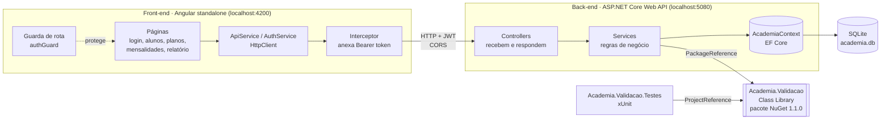
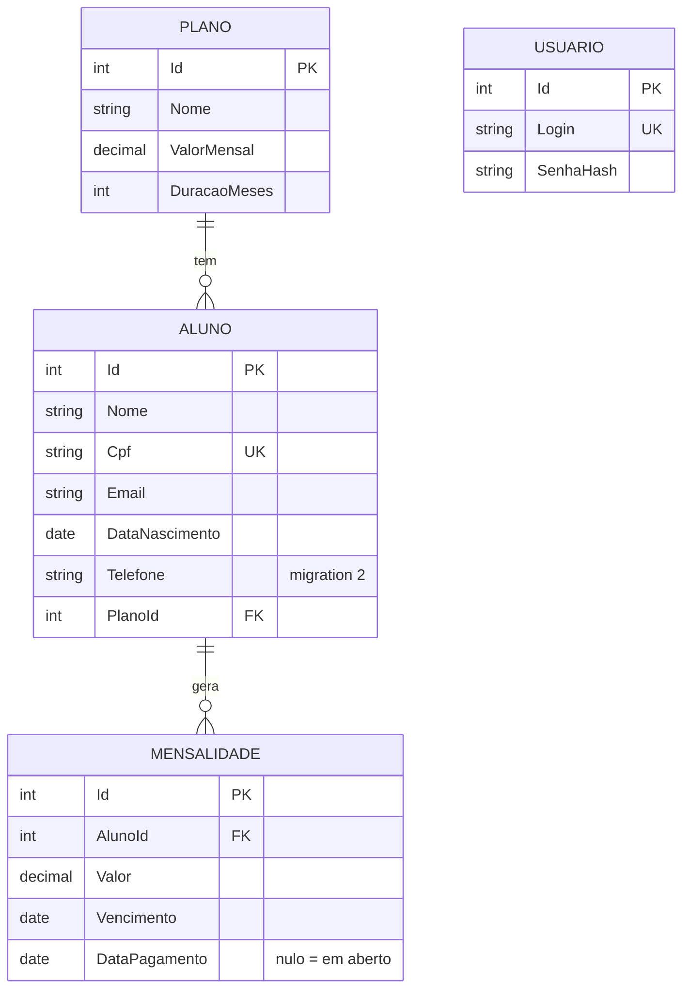

# Arquitetura

## Camadas

**Fluxo de uma requisição de escrita** (ex.: cadastrar aluno):

1. A página chama o `ApiService`, e o interceptor anexa `Authorization: Bearer <token>`.
2. O middleware JWT valida o token. Sem token, ou com token expirado, a API responde **401**.
3. O `AlunosController` recebe o DTO e chama `AlunoService.Criar`.
4. O Service valida com a biblioteca (`ValidadorAluno`), aplica as regras de negócio (CPF único, plano existe) e grava via `AcademiaContext`.
5. Se der erro, o Service lança `RegraNegocioException`, que vira **400** `{ "erros": [...] }`. Se der certo, a API responde **201** com `Location`.
6. A página mostra os erros ou volta para a lista.

## Entidades

- **Plano → Aluno:** exclusão restrita. O Service bloqueia com uma mensagem antes do banco.
- **Aluno → Mensalidade:** exclusão em cascata.

## Decisões técnicas

- **Validação numa biblioteca separada:** as regras do domínio não dependem do framework web. Dá para testá-las isoladas (xUnit) e reutilizá-las em outro projeto pelo NuGet.
- **Biblioteca como pacote NuGet (não ProjectReference):** a API depende de uma versão fixa. A evolução 1.0.0 → 1.1.0 (MINOR, pelo SemVer) adicionou a regra de telefone sem quebrar quem usa a 1.0.0.
- **Controller fino + Service:** é o padrão de camadas. O Controller só traduz HTTP, e o Service concentra a regra de negócio. Os Services entram pelo construtor (injeção de dependência), o que facilita trocar e testar.
- **DTOs em vez de entidades na resposta:** evitam ciclos de serialização (Aluno ↔ Plano) e expõem só o necessário.
- **SQLite:** é um arquivo único, sem servidor para instalar, e os dados sobrevivem a reinícios.
- **Angular standalone e zoneless, com signals:** é o padrão atual do Angular. O estado das telas fica em `signal()`, que avisa o Angular quando precisa redesenhar.
